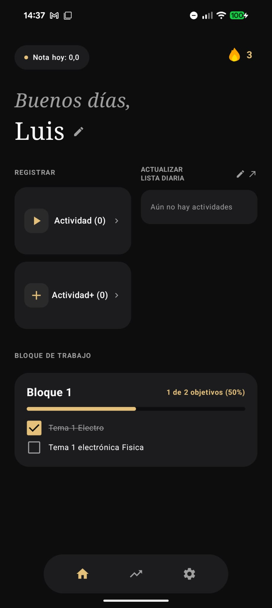
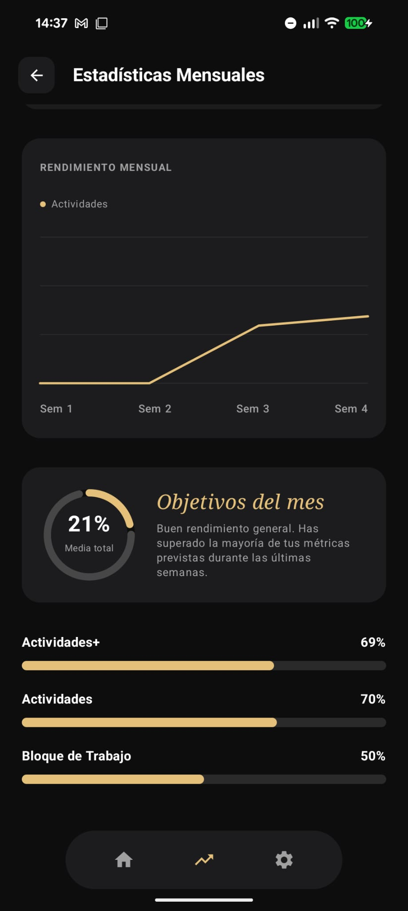
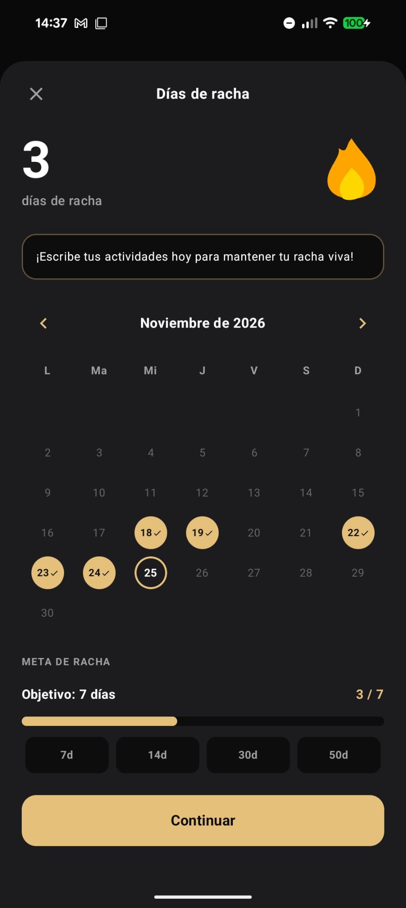
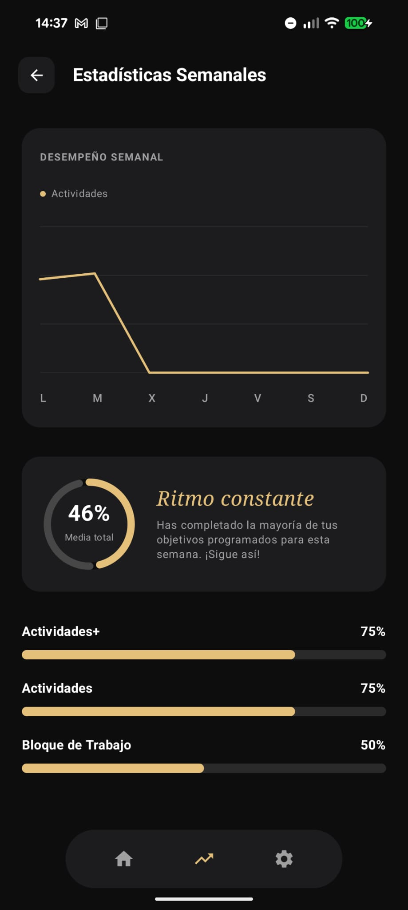

# ⏳ Tioro

> **Organiza tu tiempo y tu trabajo con honestidad. Libertad mental en un mundo de libertinaje digital.**


**Tioro** es una aplicación nativa de Android diseñada para organizar tu día a día y medir tu constancia real **sin caer en la productividad tóxica**. Acepta el ocio, exige equilibrio mediante actividades de esfuerzo, penaliza la inactividad real y funciona **100% en local** para garantizar privacidad total y velocidad instantánea.
## 📱 Capturas de Pantalla

| Inicio & Bloque de Trabajo | Estadísticas Semanales | Calendario de Racha | Backup (Máquina del Tiempo) |
| :---: | :---: | :---: | :---: |
|  |  |  |  |

---

## ✨ Características Principales

### 📋 Gestión Diaria y Bloques de Trabajo
* **Actividades vs. Actividades+:** Diferenciación clara entre actividades cotidianas/ocio y actividades de esfuerzo o prioritarias.
* **Plantillas Recurrentes:** Programa tareas para días específicos de la semana; el sistema las genera automáticamente cada mañana sin contaminar días futuros en las estadísticas.
* **Bloques de Trabajo Semanales:** Sustituye los proyectos tradicionales por un bloque directo con objetivos mayoritarios (checklist) vinculado a cada semana:
    * Al completar el 100%, el bloque queda sellado hasta el lunes siguiente.
    * Los objetivos incompletos se arrastran automáticamente a la semana siguiente sin alterar el cierre histórico de la semana anterior.

### 📊 Estadísticas Reales (Semanal, Mensual y Anual)
* **Eje X Anclado al Calendario Real:** Gráficas trazadas en `Canvas` sincronizadas estrictamente de Lunes a Domingo con `java.time.LocalDate`.
* **Penalización Estricta por Días Vacíos:** Los días en los que no se registra actividad cuentan como `0%` en la media de días transcurridos, evitando porcentajes inflados.
* **Desglose por Categoría:** Barras de completitud pura para **Actividades+**, **Actividades** y **Bloque de Trabajo**, además de sistema de medallas semanales y mensuales (`>= 60%`).
* **Resumen de Lunes:** Al iniciar cada semana, un modal resume el cierre de la semana anterior, si se obtuvo medalla y los objetivos arrastrados.

### 🔥 Sistema de Rachas Interactivo
* **Umbral de Aprobado:** Mantén tu racha superando el `50%` de nota diaria.
* **Calendario de Racha (Modal Desplegable):** Panel interactivo al estilo Duolingo adaptado a la estética oscura y dorada de Tioro, con navegación mensual, días superados marcados y barra de metas de racha.

### ⏳ Backup ("Máquina del Tiempo")
* **Edición Retroactiva:** Si olvidaste registrar o marcar una actividad de un día pasado, puedes viajar a cualquier fecha anterior (bloqueando fechas futuras) mediante un `DatePicker`.
* **Recálculo en Vivo:** Al modificar un día pasado, Tioro recalcula automáticamente las gráficas semanales, mensuales y anuales, y **restaura la racha** si el día alcanza el `>= 50%`.
* **Fricción de Honestidad:** Diseñado como un salvavidas excepcional, no como una herramienta para engañar al sistema.

### 🔔 Notificaciones Inteligentes (State-Aware)
Motor local con **WorkManager** conectado directamente a la base de datos Room. Antes de avisarte, la app comprueba tu estado real del día:
* **Modo Día en Blanco:** Avisos a las `09:00`, `12:30`, `15:30` y `18:30` *solo* si aún tienes 0 actividades registradas.
* **Seguimiento Dinámico:** Al registrar tareas, realiza un seguimiento cada 5 horas (respetando silencio nocturno estricto entre `00:00` y `08:59`).
* **Cierre Nocturno:** Avisos de urgencia a las `23:00` y `23:45` (se silencian automáticamente si ya completaste el 100% del día).
* **Recordatorio de Domingo:** Aviso a las `18:00` si tu Bloque de Trabajo semanal sigue incompleto.

### 💾 Privacidad, Portabilidad y Escritorio
* **Exportar e Importar `.json`:** Guarda una copia de seguridad local completa de tu base de datos y restaura tu historial en cualquier momento sin depender de servidores externos.
* **Widget de Escritorio:** Widget minimalista nativo en modo oscuro/dorado con tu nota de hoy, racha actual, progreso del Bloque de Trabajo y acceso directo para registrar actividades.

### 🎨 Experiencia de Usuario (UX/UI)
* **Estética Dark & Gold:** Interfaz minimalista (`#0D0D0D`, `#1C1C1E` y `#E5C07B`).
* **Navegación Fluida:** Cambio instantáneo sin parpadeos entre pestañas principales y deslizamientos laterales suaves en subpantallas.
* **Micro-interacciones:** Entrada en cascada en el Home, gráficas y barras animadas en vivo, feedback háptico con rebote al completar tareas y confirmación automática.

---

## 🧮 Motor Matemático

Tioro abstrae la complejidad matemática para que el usuario solo vea progreso limpio, pero bajo el capó aplica reglas estrictas:

1. **Nota Diaria (`0%` – `100%`):**
   $$\text{Nota Diaria} = \left(\frac{\text{Act. Completadas}}{\text{Act. Totales}} \times 36.25\right) + \left(\frac{\text{Act+ Completadas}}{\text{Act+ Totales}} \times 63.75\right)$$

2. **Media Semanal (`70%` Días + `30%` Bloque de Trabajo):**
   $$\text{Media Semanal} = (\text{Media Días Transcurridos} \times 0.70) + (\text{\% Bloque de Trabajo} \times 0.30)$$
   *(Si no se registra ningún Bloque de Trabajo en la semana, el máximo semanal alcanzable es del `70%`).*

---

## 🛠️ Stack Tecnológico

* **Lenguaje:** Kotlin
* **UI:** Jetpack Compose + Material Design 3
* **Arquitectura:** MVVM (`StateFlow` + Coroutines)
* **Base de Datos:** Room (SQLite local) con KSP
* **Preferencias:** Jetpack Preferences DataStore
* **Navegación:** Jetpack Navigation Compose
* **Tareas en Segundo Plano:** WorkManager
* **Fechas:** `java.time.LocalDate` (inmune a desfases UTC)
* **Serialización y Widgets:** `org.json` nativo y `AppWidgetProvider`

---

## 🚀 Instalación y Compilación

1. Clona el repositorio:
   ```bash
   git clone [https://github.com/TU_USUARIO/tioro.git](https://github.com/TU_USUARIO/tioro.git)
Abre el proyecto en Android Studio (Ladybug o superior recomendado).

Espera a que finalice la sincronización de Gradle (Gradle Sync).

Conecta un dispositivo Android (API 24+ / Android 7.0 o superior) o inicia un emulador y pulsa Run (▶).

🗺️ Roadmap
[x] Motor matemático diario y semanal con penalización de días vacíos

[x] Sistema de Bloques de Trabajo semanales

[x] Gráficas animadas (Semanal, Mensual y Anual)

[x] Backup retroactivo ("Máquina del Tiempo")

[x] Notificaciones locales inteligentes con WorkManager

[x] Calendario de rachas interactivo

[x] Exportación/Importación local en JSON y Widget de escritorio

[ ] Icono oficial de lanzamiento (Adaptive Launcher Icon) y Splash Screen oscura

📄 Licencia
Proyecto personal de código abierto. Siéntete libre de explorar la arquitectura o adaptarla a tu propio flujo de trabajo.
